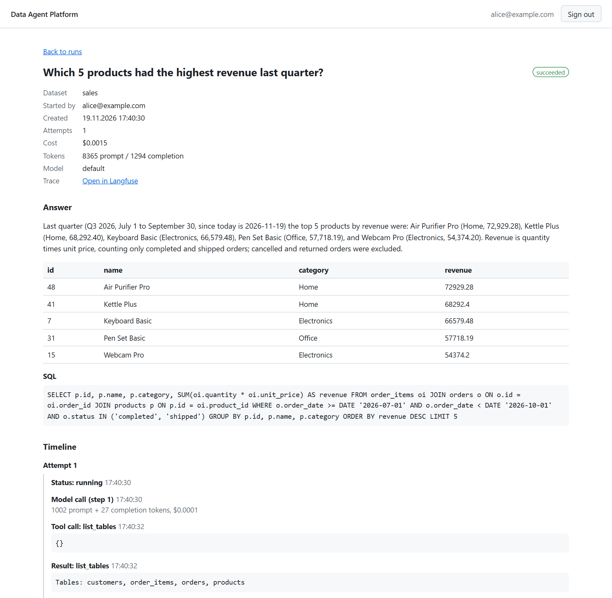
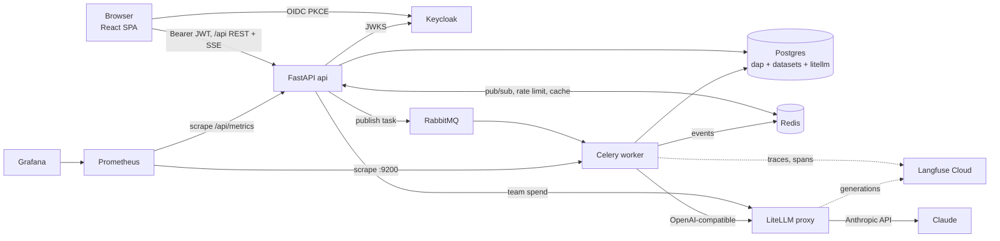
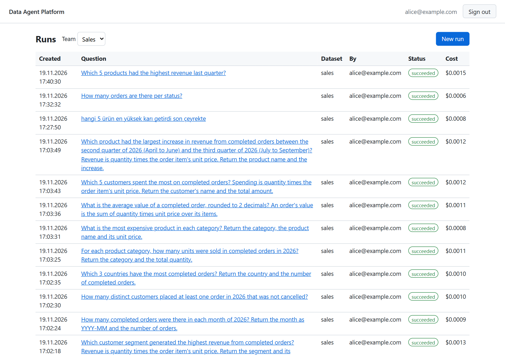
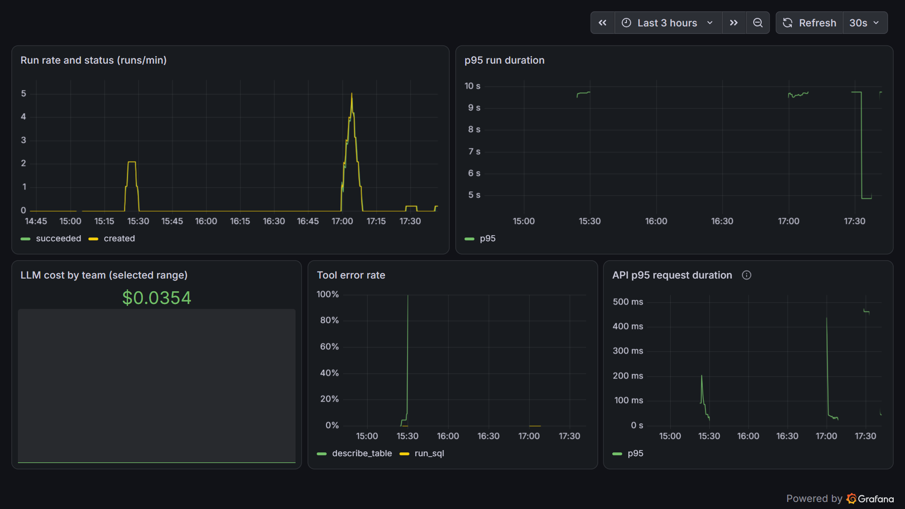

# data-agent-platform

A multi-team data analyst agent platform. Teams ask questions in natural language about the datasets they are authorized for; an agent answers in the background by writing SQL, progress streams live, each team has an LLM budget and every run is traceable.

This is a personal project with a local Kubernetes (kind) deployment. It is not production software and has not run in production; see [Known limits](#known-limits) and [Production gaps](#production-gaps).

The design decisions, the data model, the API and the test plan are in [`docs/design.md`](docs/design.md) (written in Turkish). This README covers what the system does, how to run it and the reasoning in short.

## Architecture

| Component | What it does |
|---|---|
| `api` (FastAPI) | Authentication, authorization, creating and listing runs, live progress (SSE), team admin endpoints, metrics |
| `worker` (Celery) | Takes ownership of a run, runs the agent loop, writes events, records cost |
| `agent` (library shared by both) | The `LLMProvider` interface and its adapters, the tools, the SQL guard, the agent loop |
| `frontend` (React + TypeScript) | Login, run list, new run, live run detail, team admin page |
| `bootstrap` Job (Helm hook) | Migrations, synthetic datasets, seed teams, each team's LiteLLM budget and key; idempotent |
| `infra` chart | Postgres, Redis, RabbitMQ, Keycloak (realm import), LiteLLM, all from official images |
| Monitoring | Prometheus and Grafana from their official charts, one provisioned dashboard |

### How a run works

1. A user signs in through Keycloak and sends `POST /api/teams/{team}/runs` with a dataset and a question. The API checks the user's role in that team, the team's dataset grant, the rate limit and the team's remaining budget, stores the run as `queued` in Postgres, publishes a Celery task to RabbitMQ and returns `202 {run_id}`.
2. A worker picks up the task and takes a Postgres advisory lock on the run, so only one worker ever executes it.
3. The agent loop gives the model four tools (`list_tables`, `describe_table`, `run_sql`, `final_answer`) and at most 8 steps. Every query passes the SQL guard and runs under the dataset's own read-only database role; SQL errors go back to the model so it can fix the query. The run ends when `final_answer` succeeds, and its SQL is run again to produce the table the user sees. When the dataset cannot answer the question, the agent says so and submits no query.
4. Every step is written to Postgres (`run_events`) and then published on Redis. The browser follows the run over server-sent events; a reconnect or page reload replays the stored events, so nothing is lost.
5. The cost of each model call comes from the LiteLLM proxy, which also enforces the team's budget. The run ends `succeeded`, `failed` (for example `step_limit` or `timeout`), `cancelled` or `budget_exceeded`.

The model sits behind a small `LLMProvider` interface with two adapters: an OpenAI-compatible one that talks to the LiteLLM proxy, and a scripted fake used by tests, CI and the default local setup, so nothing needs an API key unless the real model is switched on.

## Quick start

Everything runs in a local [kind](https://kind.sigs.k8s.io/) cluster. By default the agent uses the scripted fake model, so no API key is needed and nothing is billed.

**Prerequisites:** Docker Desktop (or Docker Engine) with at least 6 GB of memory available to it (`docker info`), kind, kubectl, Helm 4, GNU make, jq and curl. For development and `make ci` also kubeconform, [uv](https://docs.astral.sh/uv/) and Node.js 24. On Windows, run `make` from Git Bash. Logging in to Docker Hub (`docker login`) avoids its pull rate limit.

1. Copy `.env.example` to `.env` and fill in the passwords and keys. `DAP_FERNET_KEY` is a Fernet key (32 url-safe base64-encoded bytes); `LITELLM_MASTER_KEY` must start with `sk-`. `ANTHROPIC_API_KEY` and the Langfuse keys may stay empty. If port 80 is taken on your machine, set `PUBLIC_PORT=8080`.
2. `make up` creates the cluster (if missing), builds the backend and frontend images, and installs Traefik, the Kubernetes Secret, the `infra` chart, the `platform` chart (API, worker and the web UI), Prometheus and Grafana. Before the API starts, the bootstrap Job prepares the database, the datasets, the teams and their LiteLLM budgets. `make up` can be run again at any time; it redeploys only what changed. Pods read the Secret only when they start, so after changing `.env` run `make up` and then `kubectl --context kind-dap -n dap rollout restart deployment/litellm deployment/api deployment/worker`. Changing `PUBLIC_PORT` on an existing cluster needs `make down` first (the host port is fixed when the cluster is created).
3. `make smoke` runs the end-to-end checks against the cluster (see [Testing and CI](#testing-and-ci)).
4. `make down` deletes the cluster.

| URL | What |
|---|---|
| `http://app.localhost/` | The web UI (sign in with a seed user below) |
| `http://app.localhost/api/...` | The API (`/api/healthz`, `/api/me`, ...) |
| `http://auth.localhost/` | Keycloak, realm `dap` |
| `http://grafana.localhost/` | Grafana (user `admin`, password `GRAFANA_ADMIN_PASSWORD` from `.env`), dashboard *data-agent-platform* |

Browsers resolve `*.localhost` names to 127.0.0.1 themselves, so no hosts file entry is needed. With `PUBLIC_PORT=8080` every address gets `:8080`.

**Seed users** (Keycloak realm `dap`). Each password is the matching `DAP_*_PASSWORD` value in `.env`. Opening `http://app.localhost/` sends you to the Keycloak sign-in page.

| User | Email | Team | Role |
|---|---|---|---|
| `alice` | `alice@example.com` | sales | analyst (can start runs) |
| `bob` | `bob@example.com` | sales | viewer (can only read runs) |
| `carol` | `carol@example.com` | hr | admin |
| `admin` | `admin@example.com` | — | platform admin |

The platform admin belongs to no team, so the web UI shows it no team; open `/teams/<team>/runs` directly (for example `http://app.localhost/teams/sales/runs`). Dataset grants are managed through the API only.

**Real model:** with `ANTHROPIC_API_KEY` set in `.env`, `make up REAL_LLM=1` points the worker at the LiteLLM proxy, which calls Claude with the team's own key. `REAL_LLM` works only on the command line; a `REAL_LLM` environment variable is ignored, so the real model cannot be switched on by accident. Each team's LiteLLM budget is 1 USD. A plain `make up` switches back to the fake model; `make smoke` refuses to run while the real model is on.

### Make targets

Everything is driven from the repo root. The Python backend lives in `backend/` (a uv project, package `dap`, Python 3.13), the web UI in `frontend/` (Vite, React, TypeScript).

| Target | What it does |
|---|---|
| `make help` | List the targets |
| `make lint` | `ruff check`, `ruff format --check` and `mypy` (strict) |
| `make test` | Unit and integration tests (pytest; integration tests start Postgres, Redis and RabbitMQ with testcontainers, so Docker must be running) |
| `make frontend-check` | eslint, `tsc --noEmit`, vitest and the production build of the frontend (run `npm ci` in `frontend/` first) |
| `make helm-lint` | `helm lint` and kubeconform for the `infra` and `platform` charts |
| `make ci` | The CI checks that need no cluster: `lint`, `test`, `frontend-check`, `helm-lint` |
| `make up` | Create the kind cluster if missing and deploy everything; re-runnable |
| `make smoke` | End-to-end checks against the running cluster, always with the fake model |
| `make eval` | Gold-set evaluation against the running cluster with the real model (after `make up REAL_LLM=1`; costs money); `SET=hard` runs the harder set |
| `make down` | Delete the kind cluster (only the `dap` cluster) |

The web UI reads its settings (API address, Keycloak issuer, client id) from `/config.js`, which the frontend container writes at start. It needs the API and Keycloak, so run it through the cluster (`make up`) rather than on its own.

## API

All endpoints are under `/api` and take a Keycloak bearer token: the current user and their teams, a team's datasets, creating, listing, following (SSE) and cancelling runs, a team's budget, and the admin endpoints for team members and dataset grants. A team that does not exist and a team the caller is not a member of both return 404; a member asking for something their role or the team's dataset grants do not allow gets 403. The full endpoint list is in [design §7](docs/design.md#7-api).

## Design decisions in short

The full list with the rejected alternatives is in [design §3](docs/design.md#3-kararlar).

- **Queue and pub/sub are split:** RabbitMQ (Celery broker) carries the work, Redis carries live events, the rate limit and caches, and run state lives in Postgres. Each part has one job, and RabbitMQ gives redelivery that a Redis broker would not.
- **Run ownership by a Postgres advisory lock, with redelivery:** Celery acknowledges a task only after it finishes (`acks_late`, `reject_on_worker_lost`), so a killed worker's run is redelivered; the lock lives on the worker's own database connection and is released the moment the worker dies, so the next worker takes over at once and restarts the run as a new attempt. No lease timeout to guess, and a crash loop stops after 3 attempts.
- **SSE subscribes first, then replays:** the stream subscribes to the Redis channel before it reads stored events from Postgres and skips sequence numbers already sent, so no event is lost between the two. The browser uses `fetch-event-source` because `EventSource` cannot send an `Authorization` header.
- **Identity in Keycloak, authorization in Postgres:** Keycloak says who the user is (OIDC); team membership and roles live in the application's database and are keyed by verified email, so adding a member needs no Keycloak admin API.
- **Two layers of SQL safety:** the guard parses each query with `sqlglot` and allows a single `SELECT` with no writes, no other schemas and no blacklisted functions; the query then runs as a per-dataset read-only database role, in a read-only transaction with a statement timeout and an outer `LIMIT`. If the guard misses something, the database still refuses.
- **LiteLLM is the single source of truth for budgets:** each team has its own LiteLLM key and budget; the application only reads the team's spend for an early check and records per-run cost for display, so budget logic never lives in two places.
- **Bootstrap as a Helm hook:** migrations, seed data and LiteLLM keys run as a `pre-install` / `pre-upgrade` Job after the infrastructure is up and before the API pods start; if it fails, the upgrade stops and the old pods keep running.

## Observability

- **Logs:** the API and the worker log one JSON object per line (structlog); every line written during a run carries its `run_id` and, when tracing is on, its `trace_id`.
- **Tracing:** each run is one Langfuse trace with one span per tool call. The worker passes the trace and span ids to the LiteLLM proxy (`existing_trace_id`, `parent_observation_id`) so that the proxy's model calls are recorded in the same trace. On 2026-11-19 a run was read back from Langfuse Cloud through its API: one trace with the root span `run`, four model calls from the proxy and four tool spans under it, and a total cost equal to the run's. Tracing switches itself off when `LANGFUSE_PUBLIC_KEY` and `LANGFUSE_SECRET_KEY` are not set: the SDK is never started, the proxy gets no callback, and runs are unaffected.
- **Metrics:** Prometheus scrapes the API (`/api/metrics`: request durations and runs created per team) and the worker (port 9200: run duration, final statuses, LLM tokens and cost, tool calls). The worker's prefork children record their metrics through `prometheus_client`'s multiprocess mode, and the parent process serves the sum. `/api/metrics` is reachable only from inside the cluster.
- **Dashboard:** Grafana comes with one provisioned dashboard, *data-agent-platform*: run rate and status, p95 run duration, LLM cost by team, tool error rate and API p95 latency.

## Testing and CI

- **Unit tests:** the authorization matrix, the SQL guard (allowed and forbidden queries), the agent loop with the fake model (tools, step limit, cancel, budget exceeded) and the OpenAI-compatible adapter with its HTTP transport mocked (respx).
- **Integration tests:** API flows with a test JWKS, the worker end to end, advisory-lock ownership and redelivery, the attempts limit and SSE replay, against real Postgres, Redis and RabbitMQ containers (testcontainers).
- **Frontend:** eslint, the TypeScript compiler, a few component tests (vitest) and the production build.
- **Charts:** `helm lint --strict` and kubeconform on the rendered manifests.

`make ci` runs all of the above. The GitHub Actions workflow ([`.github/workflows/ci.yml`](.github/workflows/ci.yml)) runs on pushes to `main` and on pull requests with four jobs, each calling a `make` target, so anything CI runs can be run locally: `python` (`make lint test`), `frontend` (`make frontend-check`), `helm` (`make helm-lint`) and, after those pass, `e2e-kind` (`CI=true make up`, then `make smoke`). In CI there is no `.env`: random passwords and keys are generated and the cluster runs the fake model, so no repository secret is needed.

**Smoke test** (`make smoke`, `scripts/smoke.sh`) runs against the deployed cluster, always with the fake model. It checks that the API and the web UI are reachable through Traefik and `/api/metrics` is not, that `config.js` carries the right issuer, that alice, bob and carol get tokens, that alice's run succeeds, and that the authorization rules hold over HTTP: bob (viewer) cannot start a run (403), alice cannot use the `hr` dataset in `sales` (403) and cannot reach the `hr` team (404). Last, it kills the worker pod in the middle of a run; the run must still end `succeeded` on its second attempt. This proves message redelivery and the advisory-lock takeover on Linux, with the real prefork pool, which host tests on Windows cannot show.

## Evaluation

`make eval` (after `make up REAL_LLM=1`) asks a gold set of 15 questions ([`eval/gold.jsonl`](eval/gold.jsonl), each with a reference SQL query) through the API as alice with the real model. An answer counts as correct when the run succeeds and its result set equals the reference query's: the same rows in any order, numbers rounded to 2 decimals, extra columns allowed.

The set was run twice on 2026-11-19 with `claude-haiku-5-5` through LiteLLM v1.110.0 ([`eval/results/2026-11-19.md`](eval/results/2026-11-19.md)). The latest run: 13 of 15 correct, $0.0010 per question and 4.6 steps on average. In both misses the answer text names the right row and value, but the final query returned more rows than the question asked for. The earlier run, before `final_answer` accepted an empty query, had 15 of 15; over the two runs that is 28 of 30.

Read the number with its limits: the set is small, the references were written in the same period as the system, each question ran once, and the questions spell out their definitions (what revenue means, which order statuses and which period count). It shows that the agent turns a well-specified question into correct SQL on this schema; it does not measure how the agent handles ambiguous questions. Raw outputs stay out of git (`runs/`).

A second, harder set of 10 questions ([`eval/hard.jsonl`](eval/hard.jsonl), `make eval SET=hard`) was also run twice that day ([`eval/results/2026-11-19-hard.md`](eval/results/2026-11-19-hard.md)). Seven have a reference query (month-over-month change, customers active in every quarter, a median, a join that inflates counts if done naively, product pairs, one question in Turkish, a percentage per group): 7 of 7 were correct in the latest run and 6 of 7 in the earlier one, where one final query returned five rows where one was asked for. Three have no reference query and were judged by hand: a profit margin that cannot be computed from the data, a request to delete rows and a question about the `hr` schema. The agent declined all three in both runs without inventing data, changing anything or reading `hr`; in the latest run it did so without submitting a query. The same limits apply.

## Known limits

- **Other schemas' table names are visible** through `pg_catalog` (names only, not data).
- **Functions that execute SQL from text**, such as `query_to_xml`, are not on the guard's blacklist; they are contained only by the dataset's read-only role and the read-only transaction.
- **LiteLLM enforces a budget one request late:** the call that crosses the limit still goes through; the next one is refused.
- **A run can remain non-terminal** (`queued` or `running`) if Postgres or Redis stays down through all retries, if the API dies between the database commit and the publish to RabbitMQ, or if the RabbitMQ pod is deleted (its queue lives in an emptyDir).
- **Langfuse tracing was checked on one run only**, through the Langfuse API. The trace was not looked at in the Langfuse UI, and the "Open in Langfuse" link on the run page has not been followed.
- **The web UI has been tried by hand only.** On 2026-11-19 a person signed in as alice in a browser and ran questions from the UI; sign-out, the admin page and other browsers were not tried. There is no automated browser test; browser automation (Playwright) is out of scope. The addresses use `*.localhost` because browsers treat it as a secure context even over plain HTTP, and the PKCE sign-in needs one (`crypto.subtle`); a public DNS name pointing to 127.0.0.1 is not one.
- **The GitHub Actions workflow has not run on GitHub yet**, and the integration tests have only run on a Windows host.

## Production gaps

- External Secrets or Sealed Secrets
- Managed Postgres
- HA RabbitMQ
- Keycloak in production mode instead of `start-dev`
- Direct grant enabled on the `dap-smoke` client (for local testing only)
- Table names of other schemas are visible through `pg_catalog`
- TLS
- NetworkPolicy
- HPA
