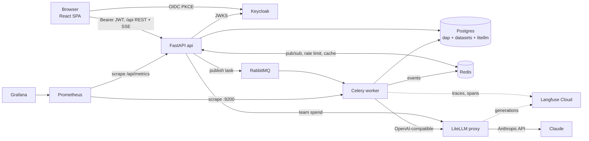

# data-agent-platform: tasarım

> Bu doküman projenin tasarım kararlarının, mimarisinin ve yapım sırasının sahibidir. Kurulum ve kullanım README'de, görev bazlı uygulama planı ve oturumun çalışma kuralları `docs/plans/` altında yaşar.

- **Tarih:** 18 Kasım 2026
- **Durum:** Tasarım onaylandı (18 Kasım 2026). Bağımsız gözden geçirmenin düzeltmeleri 19 Kasım 2026'da işlendi. Kod yok.
- **Uygulama:** Başka bir oturumda yapılacak. Çalışma kuralları `docs/plans/2026-11-18-data-agent-platform.md` dosyasında hazır. O oturum bu dokümandan aynı dosyanın "Görevler" bölümünü yazar. Kullanıcı planı uyumadan önce onaylar, gece yalnız uygulama yapılır.

## 1. Neden var

Kubernetes üzerinde çalışan kurumsal bir AI platformunun parçalarını uçtan uca kurmayı öğrenmek için yapılmış bir **kişisel proje**. Kapsadığı konular:

- Kubernetes ve Helm
- RabbitMQ, Celery ve Redis ile dağıtık iş işleme
- OIDC ile kimlik doğrulama ve RBAC
- Langfuse
- React ve TypeScript ile frontend
- Prometheus ve Grafana

**Temel ilke:** Bu bir teknoloji listesi değil, tek bir ürün. Her bileşenin üründe bir gerekçesi var (aşağıdaki tablo). README'de proje "personal project, local Kubernetes (kind) deployment" olarak sunulur. Üretim deneyimi gibi gösterilmez.

## 2. Ürün tek cümlede

Takımlar web arayüzünden kendi yetkili oldukları veri setleri hakkında doğal dilde soru sorar. Bir veri analisti ajanı soruyu arka planda SQL yazarak cevaplar. İlerleme canlı akar. Her takımın bir LLM bütçesi var ve her koşu izlenebilir.

**Demo senaryosu:**
1. `alice` (sales takımı, analyst) giriş yapar.
2. Şunu sorar: "Which 5 products had the highest revenue last quarter?"
3. Adımları canlı izler: tabloları listeleme, SQL, sonuç, cevap.
4. Koşunun maliyetini görür.
5. Arayüz ona yalnız `sales` veri setini gösterir. API'ye doğrudan `hr` veri setiyle istek atılırsa 403 döner.
6. `bob` (viewer) sales koşularını görebilir ama yeni koşu başlatamaz.

## 3. Kararlar

| # | Karar | Gerekçe | Reddedilen alternatif |
|---|---|---|---|
| K1 | Ürün: veri analisti ajanı için çok takımlı iş platformu | Kurumsal AI platformlarının yaptığı işe (ajanlar, data intelligence, kurumsal RBAC) en yakın seçenek. RBAC'ye gerçek bir anlam veriyor: hangi takım hangi veriyi sorgulayabilir. | kaprag'ı platforma çevirmek (8 GB'lık ortama sığmaz). Doküman işleme servisi (ajan tarafı zayıf kalır). |
| K2 | LLM katmanı: kendi `LLMProvider` arayüzü ve 2 adaptör. `OpenAICompatibleProvider` `base_url` ile LiteLLM'e (ya da OpenAI, Ollama, vLLM'e) gider; `FakeProvider` senaryolu yanıt verir. | Ajan döngüsü sağlayıcıdan bağımsız. Testler ve CI anahtarsız çalışır. Claude'a giden çağrıyı LiteLLM çevirdiği için ayrı bir Anthropic adaptörüne gerek yok. | Agent framework (döngüyü anladığını göstermez). Ayrı bir Anthropic adaptörü (hiçbir yolda kullanılmıyordu, gözden geçirmede çıkarıldı). |
| K3 | Cluster'da LiteLLM proxy. Worker, OpenAI uyumlu adaptörle proxy'ye gider. LiteLLM image'ı digest ile sabitlenir. | İlandaki "model gateways" ve LLMOps maddeleri. Takım başına sanal anahtar ve bütçe. | Doğrudan Anthropic (kullanıcı gateway'i seçti). |
| K4 | **Bütçenin tek doğruluk kaynağı LiteLLM.** Uygulama koşu başına maliyeti yalnızca atıf ve gösterim için kaydeder. Modellerin fiyatı LiteLLM config'inde `model_info` içinde açıkça verilir; kaynağı ve tarihi Karar günlüğüne yazılır. Bütçe aşımı HTTP koduyla değil, LiteLLM hatasının tipiyle (`budget_exceeded`) ayırt edilir (LiteLLM 1.110.0'da HTTP 422 ile gelir). LiteLLM bütçeyi bir istek gecikmeli uygular: limiti aşan ilk çağrı geçer, sonraki reddedilir. | Bütçe mantığının iki yere bölünmesi riski kapanıyor. Uygulama yeni koşu öncesi LiteLLM'den takım harcamasını okur (Redis'te 60 sn önbellek) ve aşımda erken reddeder; asıl sert sınır LiteLLM'de. Model fiyat haritasında yoksa maliyet 0 görünür ve bütçe hiç tetiklenmez; açık fiyat bunu önler. | Bütçeyi uygulamada tutmak (iki kaynak olur). |
| K5 | Langfuse Cloud. Anahtar yoksa tracing kendini kapatır: uygulama SDK'yı başlatmaz, LiteLLM config'ine callback eklenmez. | Self-host Langfuse v3 8 GB'a sığmaz. CI ve başkalarının kurulumu anahtarsız çalışmalı. | Cluster içinde self-host. |
| K6 | Trace hiyerarşisini uygulama kurar: koşu başına bir trace, her tool çağrısı için bir span. LiteLLM'e `metadata` içinde `existing_trace_id` (32 hex) ve `parent_observation_id` (16 hex) geçilir, böylece proxy'nin yazdığı generation'lar aynı trace'in ve ilgili span'in altına düşer. `trace_id` anahtarı kullanılmaz: LiteLLM o durumda trace'i kendisinin sayar. Anahtar adları LiteLLM 1.110.0'ın kaynağından ve dokümanından doğrulandı (M5 denemesi; Langfuse anahtarı olmadığı için canlı sınanmadı). | Bir koşunun bütün adımları tek bir trace'te görünür. | Yalnız proxy callback'i (tool span'leri kaybolur). |
| K7 | Kimlik Keycloak'ta (OIDC). **Takım üyeliği ve rol uygulamanın Postgres'inde.** Keycloak'tan yalnızca `platform-admin` realm rolü gelir. Realm'de bir audience mapper, `dap-web` ve `dap-smoke` client'larının token'larına `aud=dap-api` ekler. | Yaygın desen: IdP kimliği söyler, ince taneli yetki uygulamada kalır. Keycloak'ın access token'ında `aud` varsayılan olarak API'yi içermez; mapper olmadan her istek 401 alır. | Rolleri Keycloak gruplarıyla vermek. |
| K8 | Üyelik e-posta ile tutulur. API yalnız `email_verified=true` olan token'ın `email` claim'ine güvenir. | Yeni üye eklemek için Keycloak admin API gerekmez. | `sub` ile tutmak (seed ve üye ekleme zorlaşır). |
| K9 | SQL güvenliği iki katmanlı. **(1) Veritabanı:** her veri setinin kendi parolalı LOGIN rolü var (`ds_sales_ro`, `ds_hr_ro`), yalnız kendi şemasında `USAGE` ve `SELECT` yetkili. Worker veri setine o rolle bağlanır; ayrıcalıklı kullanıcı ve `SET ROLE` kullanılmaz. **(2) Uygulama:** `sqlglot` ile ayrıştırılan sorgu tek bir ifade olmalı, kökü `SELECT` olmalı, `INTO` içermemeli, ağacın hiçbir yerinde veri değiştiren bir düğüm (veri değiştiren CTE dahil) bulunmamalı, başka bir şemayla nitelenmiş tabloya başvurmamalı ve kara listedeki fonksiyonları çağırmamalı (`set_config`, `pg_sleep*`, `pg_read_*`, `pg_ls_dir`, `pg_stat_file`, `lo_*`, `dblink*`, `pg_terminate_backend`, `pg_cancel_backend`, `pg_reload_conf`, `pg_advisory*`). Sorgu `BEGIN READ ONLY` içinde, `SET LOCAL statement_timeout = '5s'` ile ve dış bir `LIMIT` sarmalıyla çalışır. | Defense in depth: SQL denetimi aşılsa bile veritabanı reddeder. `set_config` tek bir SELECT olduğu için yalnız "SELECT mi?" kontrolünden geçerdi. **Bilinen sınır:** `pg_catalog` diğer şemaların tablo adlarını gösterir (veriyi değil); README'de yazılır. | Yalnız regex/parse denetimi. Ayrıcalıklı bağlantı + `SET ROLE` (ikinci katmanı fiilen yok eder). |
| K10 | Kuyruk: Celery, broker RabbitMQ. Redis ise canlı olay yayını (pub/sub), rate limit ve önbellek için. Celery result backend kullanılmaz; durum Postgres'te. Celery ayarları: `task_acks_late=True`, `task_reject_on_worker_lost=True`, `task_acks_on_timeout=False`, `worker_prefetch_multiplier=1`, `soft_time_limit=120`, `time_limit=150`. | Her bileşenin ayrı ve savunulabilir bir rolü var. `task_reject_on_worker_lost` olmadan prefork havuzunda yalnız çocuk süreç ölürse (OOM) mesaj onaylanır ve koşu askıda kalır. Celery hard time limit aşımında mesajı varsayılan olarak onayladığından (bunu `task_reject_on_worker_lost` kapsamaz) `task_acks_on_timeout=False` ile hard limitle öldürülen koşu yeniden kuyruğa döner. | Redis'i broker yapmak (RabbitMQ açığını kapatmaz). |
| K11 | Koşu sahipliği Postgres session advisory lock ile: `pg_try_advisory_lock`, anahtar koşu kimliğinden türetilir. Kilit, havuz kullanmayan ayrı bir engine'den (`NullPool`, autocommit) açılan ve koşu bitene kadar tutulan bir bağlantıda alınır. Kilidi alamayan task koşuya dokunmaz ve 30 sn sonra yeniden dener (`self.retry`, en fazla 10 kez); yeniden denemede koşu bitmişse hiçbir şey yapmadan biter. Kilidi alan task koşuyu yalnız `queued` ya da `running` durumundaysa çalıştırır. `running` olması önceki denemenin yarıda kaldığı anlamına gelir: `runs.attempts` bir artar, koşu baştan başlar, olaylar yeni `attempt` numarasıyla ve `seq` kaldığı yerden devam ederek yazılır. `attempts` 3'ü geçerse koşu `failed` (`too_many_attempts`) olur. | Zaman aşımı tahmini yok: yavaş ama canlı bir worker kilidini kaybetmez, ölen worker'ın bağlantısı kapanınca Postgres kilidi hemen bırakır. indiviengine'deki `run_lease.py` ile aynı yaklaşım. `NullPool` şart: kilitli bir bağlantı havuza dönerse rollback kilidi bırakmaz ve kilit sızar. `attempts` sınırı, worker'ı hep çökerten bir koşunun sonsuza kadar yeniden teslim edilip her seferinde LLM'e para harcamasını önler. | Zaman aşımlı `lease_until` kolonu (süre kısa olursa canlı worker kilidini kaybeder, uzun olursa ölü worker'ın koşusu bekler). Celery'nin kendi state'ine güvenmek. |
| K12 | Canlı ilerleme SSE ile. Worker olayı önce Postgres'e (`run_events`) yazar, sonra Redis'e yayınlar. SSE ucu **önce Redis kanalına abone olur**, sonra kayıtlı olayları DB'den okuyup gönderir, sonra canlı olayları iletir; zaten gönderilmiş `seq`'ler atlanır. Her olay `attempt` taşır, arayüz yeniden başlayan koşuyu ayrı bir deneme olarak gösterir. | Sayfa yenilenince ya da bağlantı koparsa olay kaybolmaz. "Önce oku, sonra abone ol" sırası, ikisinin arasında gelen olayları kaybederdi. | WebSocket (tek yönlü akış için gereksiz). |
| K13 | Frontend'de SSE `@microsoft/fetch-event-source` ile. | Tarayıcının `EventSource`'u `Authorization` başlığı gönderemez. Token'ı query string'e koymak log'lara sızdırır. | Token'ı URL'de taşımak. |
| K14 | Local cluster kind'da. Ingress controller Traefik (resmî chart). Traefik servisi `NodePort` 30080 ile açılır; kind config'i `containerPort: 30080` → host'un `publicPort`'una (varsayılan 80) eşler. | ingress-nginx Mart 2026'da emekliye ayrıldı. Traefik chart'ı varsayılan olarak LoadBalancer servisi açar; kind'da bu servis "pending" kalır. | ingress-nginx, Envoy Gateway (daha ağır), LoadBalancer servisi. |
| K15 | Bitnami chart ve image'ları kullanılmaz. Postgres, Redis, RabbitMQ, Keycloak ve LiteLLM resmî image'larla kendi `infra` chart'ımızda kurulur. Traefik, `prometheus-community/prometheus` ve Grafana resmî chart'larıyla kurulur. | Bitnami 2025'te image dağıtımını değiştirdi. Kendi StatefulSet'lerini yazmak, mülakatta anlatılabilir K8s bilgisi demek. kube-prometheus-stack 4 GB hedefine sığmaz. | Bitnami alt chart'ları, kube-prometheus-stack. |
| K16 | Tek origin: `app.localhost` hem frontend'i hem API'yi sunar (API `/api` altında, Traefik path kuralıyla). Diğer adresler `auth.localhost` (Keycloak) ve `grafana.localhost`. Bütün dış adresler values'taki tek bir `publicPort` değerinden türetilir. Frontend'in ayarları (API adresi, OIDC issuer, client id) build anında gömülmez; container açılırken ortam değişkenlerinden `config.js` olarak üretilir. | `*.localhost` seçildi çünkü PKCE `crypto.subtle` ister, bu da güvenli bağlam (secure context) gerektirir; 127.0.0.1'e çözülen halka açık bir DNS adı düz HTTP'de güvenli bağlam değildir, tarayıcılar ise `*.localhost`'u TLS olmadan da güvenli sayar ve kendileri loopback'e çözer. Hosts dosyası kaydı gerekmez. Tek origin CORS'u tümden ortadan kaldırır. `publicPort` 8080'e dönerse (80 doluysa) issuer, redirect URI, `webOrigins` ve frontend ayarı aynı değerden türediği için yeniden build gerekmez. | Ayrı `api.` alt alanı (CORS gerektirir). Vite ortam değişkenlerini build'e gömmek. 127.0.0.1'e çözülen halka açık DNS adı (düz HTTP'de güvenli bağlam değil, PKCE çalışmaz). |
| K17 | Varsayılan model `claude-haiku-5-5`, LiteLLM'de `default` takma adıyla. `strong` takma adı `claude-sonnet-5-5`'e gider. İki model adı da LiteLLM 1.110.0 üzerinden gerçek çağrıyla doğrulandı (M5 denemesi). | Görev basit, maliyet düşük. Model adı bir ayar. | — |
| K18 | Örnek veri sentetik, sabit seed'le üretilir (Faker). İki veri seti var: `sales` ve `hr`. | Lisans sorunu yok, tekrarlanabilir. `hr` hassas veri olduğu için RBAC'ye gerekçe sağlıyor. | Kaggle veri setleri. |
| K19 | Repo dili: README, UI metinleri, commit mesajları, kod yorumları ve docstring'ler İngilizce. Bu karar global `CLAUDE.md`'deki Türkçe yorum kuralının önüne geçer. | Okuyucu Türkçe bilmeyebilir. | Türkçe yorumlar (okuyucu anlayamaz). |
| K20 | README'de AI destekli geliştirmeyi anlatan ayrı bir bölüm yok. README yalnız ürünü ve teknik kararları anlatır. | AI kullanımı mülakatta sözlü anlatılır. | "How this was built" bölümü. |
| K21 | Geliştirme ortamı yerel Windows 11. Claude Code Windows'ta çalışır; Bash aracı Git Bash'tir. Docker Desktop, Linux container'ları için gereken WSL2'yi kendisi kurar ve yönetir; kullanıcı WSL'e doğrudan dokunmaz. Araçlar `winget` ile kurulur, GNU make dahil. Kurallar: script'ler bash ve LF satır sonlu (`.gitattributes`); Python komutları her yerde `uv run` ile çağrılır (Windows'ta sanal ortam `bin/` değil `Scripts/` altındadır); container içi mutlak yol geçen `docker` ve `kubectl` çağrılarında `MSYS_NO_PATHCONV=1` kullanılır (Git Bash `/` ile başlayan yolları Windows yoluna çevirir); repo OneDrive'a bağlı bir klasörde durmaz. **Python testleri Windows host'ta koşar, bu yüzden:** async veritabanı kodu `asyncpg` kullanır (`psycopg`'un async modu Windows'un varsayılan event loop'uyla çalışmaz; `psycopg` yalnız senkron kodda, worker'da kullanılır). Host'taki testlerde Celery `solo` havuzuyla koşar, çünkü Windows prefork havuzunu ve zaman sınırlarını desteklemez. Prefork, `task_reject_on_worker_lost` ve zaman sınırı davranışı Linux'ta, kind'daki smoke'ta ve CI'da sınanır (§11). | Kullanıcı ayrı bir Linux ortamı yönetmek istemiyor; tek bir Claude Code oturumu kurulumu da yapmalı. CI Ubuntu'da koştuğu için script'ler bash kalır ve iki ortamda da aynı çalışır. | WSL2 Ubuntu içinde çalışmak (Linux'a daha yakın, ama kullanıcının ayrıca kurup yönetmesi gerekir). PowerShell script'leri (CI'da ikinci bir sürüm gerekir). |
| K22 | Gerçek model varsayılan olarak kapalı: values'ta `llm.provider: fake`. `make up REAL_LLM=1` worker'ı LiteLLM'e bağlar. Testler, CI ve `make smoke` her zaman fake modelle çalışır. | Gece boyunca API harcaması 5 $ ile sınırlı (plan). Gerçek model kazara açılamaz. | Gerçek modeli varsayılan yapmak. |
| K23 | Eval'in ham çıktıları git dışında kalır (`runs/<tarih>-eval/`). Yalnız küçük bir özet (`eval/results/<tarih>.md`: soru sayısı, doğruluk, ortalama maliyet ve adım, model, LiteLLM sürümü) commit'lenir. | README'deki sayıların kanıtı repoda görünmeli. Global "üretilen çıktılar git'e girmez" kuralına bilinçli ve dar bir istisna. | Ham çıktıları commit'lemek; hiçbir kanıtı commit'lememek. |

## 4. Mimari



**Bileşenler:**

| Bileşen | Ne yapar | Neye bağlı |
|---|---|---|
| `api` (FastAPI) | Kimlik doğrulama, yetki, koşu oluşturma, listeleme, SSE, admin uçları, metrikler | Postgres, Redis, RabbitMQ, Keycloak JWKS, LiteLLM |
| `worker` (Celery) | Koşuyu advisory lock ile sahiplenir, ajan döngüsünü çalıştırır, olay yazar, maliyeti kaydeder | Postgres, Redis, RabbitMQ, LiteLLM, Langfuse |
| `agent` (kütüphane, `api` ve `worker` paylaşır) | `LLMProvider` arayüzü ve adaptörleri, tool'lar, SQL guard, ajan döngüsü | Yalnızca arayüzler; I/O dışarıdan enjekte edilir |
| `frontend` (React + TS) | Giriş, koşu listesi, yeni koşu, canlı koşu detayı, takım admin sayfası | `api`, Keycloak |
| `bootstrap` Job (Helm hook) | Migration, seed, LiteLLM'de takım ve anahtar oluşturma. İdempotent. | Postgres, LiteLLM |
| `infra` chart | Postgres, Redis, RabbitMQ, Keycloak (realm import), LiteLLM | — |
| Monitoring | Prometheus, Grafana (tek dashboard) | — |

**Kod yerleşimi:**

```
backend/                 Python paketi (uv); dap/ altında api/, worker/, agent/, db/, authz.py
backend/tests/           unit/ ve integration/
frontend/                Vite + React + TS
deploy/kind/             kind cluster config
deploy/charts/infra/     Postgres, Redis, RabbitMQ, Keycloak, LiteLLM
deploy/charts/platform/  api, worker, frontend, bootstrap Job, Ingress
deploy/values/           traefik, prometheus, grafana, ci için values
deploy/keycloak/         realm-export.json
eval/                    gold set, runner ve results/ (yalnız özetler, K23)
scripts/                 smoke.sh, secrets.sh
Makefile                 up, down, smoke, test, lint, helm-lint, ci, eval
```

## 5. Veri modeli

**`dap` veritabanı (Alembic ile):**

| Tablo | Alanlar |
|---|---|
| `teams` | `id` (slug, pk), `name`, `litellm_team_id`, `llm_key_enc` (Fernet ile şifreli; anahtar `DAP_FERNET_KEY` Secret'ından), `created_at` |
| `memberships` | `team_id`, `email`, `role` (`viewer` / `analyst` / `admin`). pk: (`team_id`, `email`) |
| `datasets` | `id` (slug), `name`, `description`, `db_role` |
| `dataset_grants` | `team_id`, `dataset_id` |
| `runs` | `id` (uuid), `team_id`, `dataset_id`, `created_by`, `question`, `status`, `attempts`, `answer` (jsonb: metin, SQL, kolonlar, satırlar), `error`, `model`, `prompt_tokens`, `completion_tokens`, `cost_usd`, `trace_id`, `created_at`, `started_at`, `finished_at` |
| `run_events` | `id`, `run_id`, `seq`, `attempt`, `type` (`status` / `llm_call` / `tool_call` / `tool_result` / `answer` / `error`), `payload` (jsonb), `created_at`. Tekil: (`run_id`, `seq`) |
| `audit_log` | `id`, `actor`, `action`, `target`, `details` (jsonb), `at`. Admin işlemleri buraya yazılır. |

`runs.status` değerleri: `queued` → `running` → `succeeded` / `failed` / `cancelled` / `budget_exceeded`.

**`datasets` veritabanı:**
- `sales` şeması: `customers`, `products`, `orders`, `order_items` (~5.000 sipariş)
- `hr` şeması: `departments`, `employees`, `salaries`
- LOGIN rolleri: `ds_sales_ro` ve `ds_hr_ro`, parolaları Secret'tan. Her biri yalnızca kendi şemasında `USAGE` ve `SELECT` yetkisine sahip (K9).

**Seed (bootstrap Job):**

| Kullanıcı | E-posta | Takım | Rol | Not |
|---|---|---|---|---|
| `alice` | `alice@example.com` | sales | analyst | |
| `bob` | `bob@example.com` | sales | viewer | |
| `carol` | `carol@example.com` | hr | admin | |
| `admin` | `admin@example.com` | — | — | `platform-admin` realm rolü |

Erişim izinleri: `sales` takımı → `sales` veri seti, `hr` takımı → `hr` veri seti. Kullanıcılar Keycloak realm export'unda sabit `id`, doğrulanmış e-posta ve `${ENV}` yer tutuculu parolayla tanımlıdır. Parolalar `.env`'den gelir ve repoya girmez. Yer tutucu `${DEGISKEN}` biçiminde yazılır ve değeri Keycloak container'ının ortamından okunur (Keycloak 26.8.2 ile M5 denemesinde doğrulandı; `${env.DEGISKEN}` biçimi çalışmaz).

## 6. Yetki modeli

Tek yer: `dap/authz.py`. Saf fonksiyon: `can(user, action, team, resource=None) -> bool`. `resource` gerektiğinde veri seti kimliğini (koşu başlatma) ya da koşuyu (iptalde sahiplik) taşır. Matrisin her satırı testle kapsanır.

| Eylem | viewer | analyst | admin (takım) | platform-admin |
|---|---|---|---|---|
| Takım koşularını görme | ✓ | ✓ | ✓ | ✓ |
| Koşu başlatma (izinli veri setinde) | | ✓ | ✓ | ✓ |
| Koşu iptali | | yalnız kendi koşusu | ✓ | ✓ |
| Bütçe ve harcamayı görme | | | ✓ | ✓ |
| Üye ekleme / çıkarma / rol değiştirme | | | ✓ | ✓ |
| Veri seti izni verme / geri alma | | | | ✓ |

Üye olmayan bir kullanıcı takımın hiçbir kaynağını göremez. Var olmayan takımla yetkisiz takım ayırt edilmesin diye ikisi de 404 döner. Takım üyesinin izinsiz veri setiyle isteği 403 döner.

## 7. API

Bütün uçlar `/api` altındadır (K16).

| Uç | Açıklama |
|---|---|
| `GET /api/healthz`, `GET /api/readyz`, `GET /api/metrics` | `readyz`, Postgres, Redis ve RabbitMQ'yu kontrol eder. `metrics` Ingress'te dışarı açılmaz, yalnız cluster içinden kazınır. |
| `GET /api/me` | Kullanıcı, takımları ve rolleri |
| `GET /api/teams/{team}/datasets` | Takımın izinli veri setleri |
| `POST /api/teams/{team}/runs` | `{dataset, question}` → `202 {run_id}`. Rate limit: kullanıcı başına dakikada 5. Bütçe ön kontrolü yapılır; limit dolmuşsa 402 döner. |
| `GET /api/teams/{team}/runs` | Cursor ile sayfalı liste |
| `GET /api/runs/{id}` | Detay (takım üyeliği kontrol edilir) |
| `GET /api/runs/{id}/events` | SSE, K12'deki sırayla. `Last-Event-ID` desteklenir. |
| `POST /api/runs/{id}/cancel` | İptal bayrağını Redis'e yazar. Worker adımlar arasında bu bayrağı kontrol eder. |
| `GET /api/teams/{team}/budget` | LiteLLM'den harcama ve limit, uygulamadan koşu bazında döküm |
| `PUT` / `DELETE /api/teams/{team}/members/{email}` | Takım admin'i yönetir. Audit log'a yazılır. |
| `PUT` / `DELETE /api/teams/{team}/datasets/{dataset}` | Platform admin yönetir. Audit log'a yazılır. |

**JWT doğrulaması:**
- Beklenen `iss` ile JWKS adresi ayrı ayarlardır. `OIDC_ISSUER` dış adrestir (`http://auth.localhost[:publicPort]/realms/dap`), `OIDC_JWKS_URL` cluster içi servis adresidir.
- Keycloak'ta `KC_HOSTNAME` dış adrese ayarlanır, böylece tarayıcıdan ve cluster içinden alınan token'ların `iss` değeri aynı olur. Bu, kind + Keycloak kurulumunda en sık yaşanan hatadır.
- `aud` içinde `dap-api` aranır (K7), `email_verified=true` istenir (K8).

## 8. Ajan

- **Döngü:** En fazla 8 adım. Her adımda model ya bir tool çağırır ya da `final_answer` tool'unu çağırır. Yapılandırılmış çıktı bu tool üzerinden alınır.
- **Tool'lar:**
  - `list_tables`
  - `describe_table(table)`: şema bilgisi Redis'te önbelleklenir.
  - `run_sql(sql)`: K9'daki guard'dan geçer, modele en fazla 50 satır döner, satırlar kırpılır.
  - `final_answer(answer, sql)`: kullanıcıya gösterilecek sonuç bu SQL'in yeniden çalıştırılmasıyla elde edilir (en fazla 200 satır). Veri seti soruyu cevaplayamıyorsa (veri yok ya da istek okuma değil) `sql` boş verilir; sorgu çalışmaz, kullanıcı yalnız metni görür.
- **SQL hataları** modele tool hatası olarak geri döner. Model düzeltmeyi deneyebilir, bu adım sayısına dahil.
- **`LLMProvider` arayüzü:** `complete(messages, tools, model, metadata) -> LLMResponse`. `LLMResponse` şunları taşır: metin, tool çağrıları, token sayıları ve (varsa) maliyet. Adaptörler (K2):
  - `OpenAICompatibleProvider`: `base_url` ile LiteLLM'e gider. Maliyeti `x-litellm-response-cost` yanıt başlığından okur; OpenAI SDK'sında başlığa erişmek için `with_raw_response` kullanılır.
  - `FakeProvider`: senaryolu yanıt verir; test, CI ve `make smoke`'ta kullanılır. Adımlar arasına ayarlanabilir bir bekleme konabilir (`FAKE_STEP_DELAY_S`); smoke'taki worker öldürme senaryosu koşunun yeterince uzun sürmesi için bunu kullanır.
- **Hata yönetimi:**

| Durum | Davranış |
|---|---|
| 429, 5xx, zaman aşımı | Adım içinde üstel bekleme ile 3 deneme |
| LiteLLM bütçe aşımı (hata tipi `budget_exceeded`) | Koşu `budget_exceeded` olur |
| Adım sınırı | Koşu `failed`, hata `step_limit` |
| Worker süreci ya da pod'u ölür | `task_reject_on_worker_lost` sayesinde mesaj onaylanmaz ve RabbitMQ yeniden teslim eder. Kilit ölen bağlantıyla düşer; yeni worker kilidi alır, `attempts`'ı artırır ve koşuyu baştan çalıştırır (K10, K11). |
| `attempts` > 3 | Koşu `failed`, hata `too_many_attempts` |
| İptal | Bir sonraki adım başında `cancelled` |
| `soft_time_limit` (120 sn) | Koşu `failed`, hata `timeout`. `time_limit` (150 sn) süreci zorla sonlandırır. |

## 9. Gözlemlenebilirlik

- **Log:** structlog ile JSON. Her satırda `run_id` ve `trace_id` bulunur.
- **Metrikler:**
  - API: istek süresi histogramı (`prometheus-fastapi-instrumentator`), `dap_runs_created_total{team}`
  - Worker (`:9200`): `dap_run_duration_seconds`, `dap_runs_finished_total{status}`, `dap_llm_tokens_total{model,direction}`, `dap_llm_cost_usd_total{team}`, `dap_tool_calls_total{tool,outcome}`. Prefork havuzunda metrikler çocuk süreçlerde biriktiği için `prometheus_client` multiprocess modunda çalışır (`PROMETHEUS_MULTIPROC_DIR`, `emptyDir` volume).
- **Prometheus:** `prometheus-community/prometheus` chart'ı, pod annotation'larıyla kazıma (K15).
- **Grafana:** ConfigMap ile provision edilen tek dashboard. Panelleri: koşu hızı ve durum dağılımı, p95 koşu süresi, takım bazında maliyet, tool hata oranı, API p95.
- **Langfuse:** K5 ve K6'daki gibi. UI'daki koşu detayında Langfuse trace linki görünür (anahtar varsa).

## 10. Kubernetes

- **kind config:** tek node. `containerPort: 30080` (Traefik NodePort) → host'un `publicPort`'u (varsayılan 80) (K14).
- **`make up` sırası:**
  1. kind cluster
  2. Traefik
  3. Secret'lar (`scripts/secrets.sh`). Yerelde `.env`'den okur; `CI=true` ise eksik değerler için rastgele parola ve anahtar üretir.
  4. `infra` chart, `helm install --wait` ile
  5. `platform` chart. Bootstrap Job `pre-install` / `pre-upgrade` hook'udur. Job'ın kullandığı ConfigMap ve ServiceAccount da hook kaynağıdır ve daha düşük `helm.sh/hook-weight` alır, böylece Job'dan önce oluşur. `infra` ayakta olduğu için migration, seed ve LiteLLM anahtarları api pod'ları başlamadan hazır olur. Job başarısız olursa sürüm yükseltmesi durur ve eski pod'lar çalışmaya devam eder.
  6. Prometheus ve Grafana
- **Her Deployment'ta:**
  - `requests` ve `limits`
  - Probe'lar:
    - **api:** liveness `/api/healthz`, readiness `/api/readyz`
    - **worker:** yalnız liveness. Exec probe ile `celery inspect ping -d celery@$HOSTNAME`: timeout 10 sn, period 60 sn. Worker trafik almadığı için readiness'ı yok.
    - **LiteLLM:** ilk açılıştaki veritabanı migration'ına zaman tanıyan bir `startupProbe`
  - `securityContext` (`runAsNonRoot`, `readOnlyRootFilesystem` mümkün olan yerde)
  - ConfigMap ve Secret'tan env
- **Postgres:** tek bir StatefulSet, PVC ile. Üç veritabanı barındırır: `dap`, `datasets`, `litellm`.
- **Image'lar:** `make up` kendi image'larını build edip `kind load` ile cluster'a yükler. Registry gerekmez. Docker Hub çekme sınırına takılmamak için Docker'a giriş yapılmış olmalıdır (ön koşullar).
- **Bellek:** cluster hedefi 4 GB'ın altında. Docker Desktop varsayılan olarak bilgisayar RAM'inin yarısını kullanır; image build'leri, testcontainers ve kind bu payı paylaşır. Docker'ın gördüğü bellek en az 6 GB olmalıdır (`docker info`). Gerçek kullanım `docker stats` ile ölçülür ve Karar günlüğüne yazılır.
- **Port:** Windows'ta 80 portu doluysa (IIS gibi) `publicPort` 8080 olur. Bütün dış adresler bu değerden türediği için başka bir şey değişmez (K16).
- **README'deki "Production gaps" bölümü** eksikleri dürüstçe listeler:
  - External Secrets ya da Sealed Secrets
  - Yönetilen Postgres
  - HA RabbitMQ
  - Keycloak'ın `start-dev` yerine production modu
  - `dap-smoke` client'ında açık olan direct grant (yalnız yerel test için)
  - `pg_catalog` üzerinden diğer şemaların tablo adlarının görünmesi (K9)
  - TLS
  - NetworkPolicy
  - HPA

## 11. Test

| Katman | Kapsam | Araç |
|---|---|---|
| Unit | yetki matrisi (`resource` dahil); SQL guard: izinli örnekler ve yasaklı örnekler (DML, DDL, çoklu ifade, `SELECT INTO`, veri değiştiren CTE, `set_config`, `pg_sleep`, şema dışı tablo); FakeProvider ile ajan döngüsü (tool → final, adım sınırı, iptal, bütçe aşımı); OpenAI uyumlu adaptör (HTTP mock, maliyet başlığı, `budget_exceeded` hata tipi) | pytest, respx |
| Integration | API akışları; test içinde üretilen RSA anahtarıyla sahte JWKS (`aud`, `email_verified` kontrolleri dahil); uçtan uca worker (Celery test worker, `solo` havuzu + FakeProvider); advisory lock (kilit tutulurken ikinci task koşuya dokunmaz ve retry eder; kilidi tutan bağlantı kapanınca koşuyu alır, `attempts` artar; kilit `NullPool` bağlantısında kalır, havuza sızmaz); `attempts` sınırı; SSE (abone ol → replay → canlı sırasında olay kaybı ve tekrar yok) | pytest, testcontainers (Postgres, Redis, RabbitMQ) |
| Frontend | tip kontrolü, lint, birkaç bileşen testi | tsc, eslint, vitest |
| Helm | şablonlar ve şema | `helm lint`, kubeconform |
| E2E (kind) | `scripts/smoke.sh`, her zaman fake modelle (K22). alice için direct grant token alınır (yalnız `dap-smoke` client'ında açık), koşu başlatılır, `succeeded` beklenir. bob'un `POST` isteği 403 almalı. alice'in `sales` takımında `hr` veri setiyle açtığı koşu 403 almalı. alice'in `hr` takımına isteği 404 almalı. **Worker ölümü:** `FAKE_STEP_DELAY_S` ile uzatılan bir koşu sürerken worker pod'u `kubectl delete pod --grace-period=0 --force` ile öldürülür; koşu sonunda `attempts=2` ile `succeeded` olmalı (K10, K11). Bu senaryo Windows host'ta sınanamayan davranışların yerel kanıtıdır. Çözücü `*.localhost`'u loopback'e çözmezse `curl --resolve` ile 127.0.0.1'e yönlendirilir. | bash, curl, jq |
| Eval (elle, ertesi gün) | `eval/gold.jsonl`: 15 soru ve referans SQL. Ajan API üzerinden alice'in token'ıyla, `REAL_LLM=1` ile koşturulur. Sonuç kümesi referansla karşılaştırılır (sıra bağımsız, sayılar yuvarlanır). Rapor: doğruluk, ortalama maliyet, ortalama adım sayısı. Ham çıktı `runs/`'a, özet `eval/results/`'a yazılır (K23). README'de sınırı açıkça yazılır: 15 soru, referanslar sistemle aynı dönemde yazıldı. | Python |

## 12. CI (GitHub Actions)

`ci.yml`, push ve PR'da çalışır. Bütün adımlar `make` hedeflerini çağırır, böylece CI'da koşan her şey lokal olarak da koşturulabilir. İşler:

1. **python:** `make lint test`
2. **frontend:** `make frontend-check` (lint, tsc, vitest, build)
3. **helm:** `make helm-lint`
4. **e2e-kind:** ilk üçünden sonra çalışır. `CI=true make up` ve ardından `make smoke`.

## 13. Yapım sırası

Her görev kendi commit'iyle kapanır, bir kilometre taşı birden çok görevden oluşabilir (commit kuralları planda). Push yapılmaz. README taslağı her kilometre taşının sonunda güncellenir, böylece yarım kalan bir gece de gösterilebilir bir sonuç bırakır.

**Gece kapsamı M0–M8.** M9 ertesi gün kullanıcıyla birlikte yapılır.

| # | Kilometre taşı | Bitti sayılır |
|---|---|---|
| M0 | İskelet: uv, ruff, mypy, pytest, Makefile, `.env.example`, README taslağı | `make lint test` geçer (tek bir yer tutucu testle; pytest test bulamazsa hata koduyla çıkar) |
| M1 | DB: modeller, Alembic, seed, sentetik veri üreticisi, veri seti LOGIN rolleri | Migration testi geçer; `ds_sales_ro` ile `hr` okunamaz |
| M2 | Ajan çekirdeği: arayüz, 2 adaptör, tool'lar, SQL guard, döngü | Unit testler geçer |
| M3 | API: JWT, yetki, uçlar, rate limit, bütçe ön kontrolü, SSE | Integration testler geçer |
| M4 | Worker: Celery/RabbitMQ ayarları, advisory lock, `attempts`, olaylar, iptal, bütçe aşımı, Langfuse | Uçtan uca integration testi geçer |
| M5 | Kubernetes. **Önce doğrulama denemesi (yaklaşık 30 dk):** kind + Traefik ile Git Bash'ten `curl` 80 portuna ulaşıyor mu; Keycloak realm import'u `${ENV}` yer tutucusunu destekliyor mu; LiteLLM model adları ve bütçe aşımı hatasının gerçek biçimi; Langfuse metadata anahtarları. Sonuçlar Karar günlüğüne yazılır. Sonra: container'lar, iki chart, kind, Keycloak realm, LiteLLM, bootstrap. | `make up && make smoke` geçer (fake model). Ardından `make up REAL_LLM=1` ile tek bir elle koşu `succeeded` olur ve maliyeti LiteLLM'de görünür. |
| M6 | Metrikler, Prometheus, Grafana dashboard | Bir koşudan sonra Prometheus'a `curl` ile atılan sorgu worker ve API metriklerini döndürür; dashboard ConfigMap'i yüklüdür |
| M7 | Frontend: OIDC PKCE, 4 sayfa, canlı SSE zaman çizelgesi, runtime `config.js`; frontend image'ı ve chart şablonu | Build, tsc, vitest geçer; `make up` sonrası `app.localhost` 200 döner. Tarayıcıda giriş denemesi sabaha kullanıcıya kalır. |
| M8 | CI workflow | Workflow yalnız `make` hedeflerini çağırır ve bu hedefler lokal olarak geçer. GitHub'daki ilk koşu kullanıcının push'undan sonra görülür. |
| M9 | **Ertesi gün:** eval, README son hali, ekran görüntüleri | `eval/results/<tarih>.md` yazılır; README'deki her sayı ona dayanır |

**Ön koşullar ve kurulum (yerel Windows 11, K21).** Kullanıcının önceden yaptığı tek şey Windows'a Claude Code'u (Git for Windows dahil) kurmaktır. Geri kalanını uygulama oturumu **1. aşamada, kullanıcı bilgisayarın başındayken** yapar (plan dosyası, Akış). Gece hiçbir kurulum yapılmaz.

1. **Çalışma klasörü.** Oturum boş bir `data-agent-platform` klasöründe açılır ve repo doğrudan bu klasöre klonlanır. Klasör OneDrive'a bağlı olmamalıdır (Masaüstü ya da Belgeler OneDrive'a yönlendirilmişse başka bir yer seçilir). Oturumun dosya izinleri çalışma klasörünü kapsadığı için repo bu klasörün kendisidir.
2. **Araçlar.** Eksik olanlar `winget` ile kurulur: Docker Desktop, kind, kubectl, Helm, kubeconform, uv, Node.js LTS, GitHub CLI, GNU make, jq. Paket kimlikleri `winget search` ile doğrulanır. winget'te olmayan bir araç (kubeconform olabilir) resmî GitHub release'inden indirilir ve kullanıcı dizinindeki bir araç klasörüne konup PATH'e eklenir. Yönetici izni (UAC) pencerelerini kullanıcı onaylar.
3. **Docker Desktop'ın ilk açılışı.** Lisans sözleşmesini ve WSL2 kurulumunu kullanıcı onaylar. Yeniden başlatma gerekirse kullanıcı bilgisayarı yeniden başlatır ve Claude Code'u aynı klasörde `claude --continue` ile açar; oturum kaldığı yerden devam eder.
4. **Docker belleği.** `docker info` ile ölçülür, en az 6 GB olmalıdır. Daha azsa oturum durumu kullanıcıya söyler.
5. **GitHub.** `gh auth login` ile kullanıcı tarayıcıda kişisel hesabına (`YusufAltuntas`) giriş yapar. Repo klonlanır, `git config core.longpaths true` ayarlanır. İsteğe bağlı olarak `docker login` (Docker Hub çekme sınırı); Docker Hub hesabı yoksa atlanır ve risk Karar günlüğüne yazılır.
6. **`.env`.** Oturum repo kökünde `.env`'i oluşturur, seed kullanıcılarının parolalarını rastgele üretir ve `ANTHROPIC_API_KEY` alanını boş bırakır. Anahtarı kullanıcı dosyaya kendisi yapıştırır. Oturum anahtarın değerini hiçbir zaman ekrana yazdırmaz.
7. **Kurallar ve skill'ler repoda.** Proje kuralları `CLAUDE.md`'de, `subagent-driven-development` skill'i `.claude/skills/` altındadır. Ayrıca kopyalanacak bir şey yoktur. (İkisi de repo public yapılırken git'ten çıkarıldı.)
8. **Bilgisayarın uyumaması.** Kullanıcı Windows'ta prize takılıyken uyku modunu kapatır (Ayarlar → Sistem → Güç). Uyku moduna geçen bir bilgisayarda gece oturumu durur.
9. **Kontrol.** `docker run --rm hello-world`, `kind version`, `kubectl version --client`, `helm version`, `kubeconform -v`, `make --version`, `uv --version`, `node --version`, `jq --version` çalışmalı. Çıktılar kullanıcıya gösterilir.

## 14. Kapsam dışı

- HPA ve autoscaling
- Loki ve Tempo
- Grafana alarmları
- Çoklu node
- TLS
- Gerçek bulut deploy'u
- Kullanıcı kaydı
- Ajanın Python çalıştırması (güvenlik riski; hesaplamayı SQL yapar)
- Doküman / RAG
- LiteLLM'in kendi admin UI'ı
- Tarayıcı otomasyonuyla (Playwright) uçtan uca UI testi
